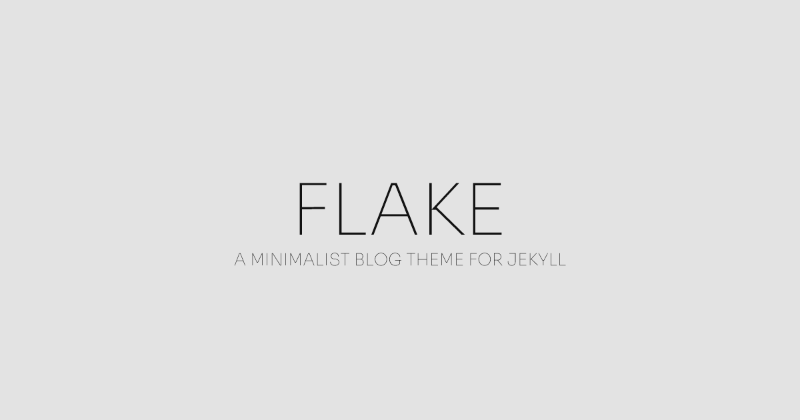

# Flake



Flake is a minimalist blog theme for [Jekyll](https://jekyllrb.com), made for those who want a pretty yet simple blog — fast and featureful.

## Features

- **Blog** — write, customize and organize your posts.
- **Projects** — showcase your work with a dedicated page for each project.
- **Custom elements** — enrich your posts with Flake's custom elements.
- **Themes** — light and dark mode.
- **Syntax highlighting** — powered by Rouge.

# Screenshots

Here are a couple of Flake's screenshots:


## Installation

Add Flake to your site's `Gemfile`:

```ruby
gem "flake", git: "https://github.com/astreuw/flake"

group :jekyll_plugins do
  gem "jekyll-feed"
  gem "jekyll-paginate"
  gem "jekyll-sitemap"
end
```

Set it as the theme in `_config.yml`:

```yaml
theme: flake
```

Then install the dependencies and start the server:

```bash
bundle install
bundle exec jekyll serve
```

Alternatively, you can fork or clone this repository and use it as the base for your site.

## License

© 2026 Ricardo Costa. Distributed under the [MIT License](LICENSE.txt).
